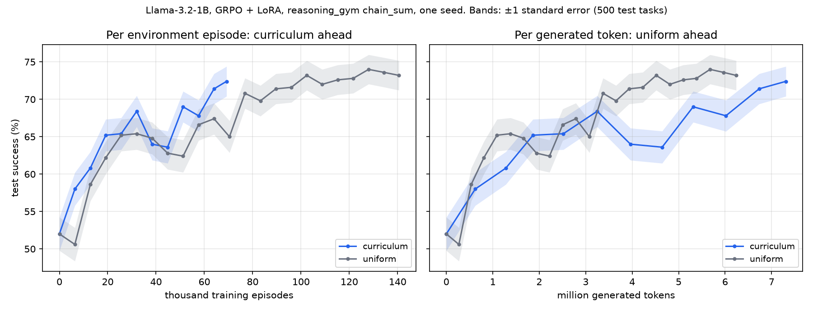

# RFC 013 pilot: GRPO + curriculum on OpenEnv, on one laptop

This branch holds only the pilot behind the Preliminary Results of
[RFC 013: Task Sampling and In-Training Evaluation](https://github.com/Matheus-F-Scatolin/OpenEnv/blob/rfc/013-task-sampling/rfcs/013-task-sampling-and-training-evals.md).
It is a standalone script, not the API the RFC proposes.

- [`pilot/README.md`](pilot/README.md): setup, commands, and the smoke and pilot results.
- [`pilot/smoke.py`](pilot/smoke.py): the GRPO loop (MLX, LoRA) and the evaluation on a fixed test split.
- [`pilot/curriculum.py`](pilot/curriculum.py): `UniformSampler` and `CurriculumSampler` as used in the pilot (signal-only weights).
- [`pilot/rfc_figure.py`](pilot/rfc_figure.py): the figure above and the matched-step table in the RFC.
- [`pilot/runs/`](pilot/runs/): per-step and per-eval logs (`log.jsonl`) and sampler states. The trained LoRA adapters are not included (45 MB each).

`pilot/vendor/reasoning_gym_env/` is copied from huggingface/OpenEnv at commit `9e0fd9b`
and keeps that project's BSD-3-Clause license.

Authors: @Matheus-F-Scatolin, @tiagoperrupato.
