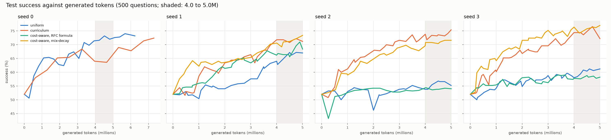

# RFC 013 trial: GRPO + four samplers on three more seeds, on one laptop

This branch holds the trial reported in the Preliminary Results of
[RFC 013: Task Sampling and In-Training Evaluation](https://github.com/Matheus-F-Scatolin/OpenEnv/blob/rfc/013-task-sampling/rfcs/013-task-sampling-and-training-evals.md)
([huggingface/OpenEnv#1256](https://github.com/huggingface/OpenEnv/pull/1256)): the trainer, the 28 run logs,
the scripts that turn the logs into every table and figure, and the predictions written before the runs.
It follows the pilot on [`rfc-013-pilot`](https://github.com/Matheus-F-Scatolin/OpenEnv/tree/rfc-013-pilot).
Like the pilot, it is a standalone trainer, not the API the RFC proposes; only its sampler library follows the
RFC's `TaskSampler` interface.

- **Setup**: Llama-3.2-1B-Instruct (`mlx-community/Llama-3.2-1B-Instruct-bf16`), GRPO with LoRA in MLX, on
  `reasoning_gym_env` `chain_sum` in the pilot's five difficulty levels. 8 prompts of 8 answers per step, at most
  384 tokens per answer. The date in the prompt is fixed to `26 Sep 2026`, the day of the pilot.
- **Evaluation**: the same 500 test questions (100 per level) in every training run, answered greedily at step 0,
  every 100 steps (every 10 in the 30-step runs), every 250,000 generated tokens in the 5-million-token runs, and
  at the end of each run.
- **Runs**: started between 2026-10-12 21:51 and 2026-10-13 22:35 UTC, on a 24 GB Apple Silicon laptop. The
  highest peak memory any run logged is 15.4 GB.



## What is on this branch

- [`samplers/`](samplers/): the `TaskSampler` protocol, `UniformSampler` and `CurriculumSampler`, written to the
  interface the RFC proposes, outside OpenEnv.
- [`trial/`](trial/): the trainer, `python -m trial.train`. Of the modules it uses, only `trial/mlx_policy.py`
  imports MLX. `trial/run_queue.py` runs a list of runs and skips the complete ones; `trial/compare_logs.py` says
  whether two logs describe the same training; `trial/smoke_pinned.py` is the pilot's script with the date fixed,
  a token budget and a closing `done` line, kept as a fallback and not used for any run here (it imports MLX too).
- [`trial/lists/`](trial/lists/): the run lists, one JSON entry per run (its folder and its command).
- [`trial/runs/`](trial/runs/): the 28 run folders, 95 MB. Layout below.
- [`analysis/`](analysis/): `validate_run` checks a run folder; `report` writes every table and figure;
  `pilot_evidence/` reads the pilot's logs a second time.
- [`tests/`](tests/): 303 tests. None needs MLX or a GPU.
- [`pilot/`](pilot/): the pilot, as on `rfc-013-pilot`, except one sentence of `pilot/README.md` worded
  differently. The trainer and the tests import from it; the analysis reads its logs.
- [`notes/expectations.md`](notes/expectations.md): the questions, predictions and reading rules, written before
  the runs and unchanged since. See below.
- [`notes/results/`](notes/results/): the six tables `analysis.report` writes, and its second reading of the
  pilot's logs (`pilot-evidence.txt`). [`trial.md`](notes/results/trial.md)
  holds test success per run and the differences between methods.
- [`figures/`](figures/): the three `trial-*.png` figures from `analysis.report`, and the pilot's figure from
  `pilot/rfc_figure.py`.
- `pyproject.toml`, `uv.lock`, `.python-version`: Python 3.12, with the pilot's versions of every library
  (`tests/test_lock_parity.py` checks this).

The project lived in a folder named `rfc-013/` of the authors' working repository. Some docstrings and one error
message still say `rfc-013/`: that folder is the root of this branch.

## Regenerate every table and figure

No GPU and no MLX are needed:

```bash
git clone --single-branch -b rfc-013-trial https://github.com/Matheus-F-Scatolin/OpenEnv.git rfc-013-trial
cd rfc-013-trial && uv sync --locked
uv run python -m analysis.report
git diff --stat
```

The report rewrites the seven files of `notes/results/` and the three `trial-*.png` figures. On macOS (Apple
Silicon) the rewritten files were identical, byte for byte, to the committed ones, so `git diff --stat` shows
nothing. Other platforms were not tried; their PNG bytes may differ.

## Run the tests

```bash
uv run pytest -q
```

Run them in a git clone, not in an unpacked archive: 36 of them make tiny runs that must log a git commit. Two of
them compare a fresh reading of the pilot's logs with `notes/results/pilot-evidence.txt`, which the report also
rewrites, so run them on a clean tree.

## Run the trial again

On an Apple Silicon Mac with 24 GB, from the root of a clone:

```bash
uv sync --locked --group train
uv run hf download mlx-community/Llama-3.2-1B-Instruct-bf16
export HF_HUB_OFFLINE=1
uv run python -m trial.preflight
mv trial/runs trial/runs-published
caffeinate -is uv run python -m trial.run_queue trial/lists/ten-run.json trial/lists/probes.json trial/lists/trial.json trial/lists/cost-rfc.json trial/lists/cost-mix-decay.json trial/lists/seed0-repeat.json trial/lists/seed3.json trial/lists/seed3-mix-decay.json
uv run python -m analysis.validate_run trial/runs
```

- Without `--group train`, `uv sync` does not install MLX.
- The logs record model snapshot `863c846a9ac6fad4e49e1743d52984dff262e953`; the preflight prints the snapshot
  on your machine and ends with `preflight: OK`.
- The queue skips every complete run folder, so the published runs are moved aside first. Add `--dry-run` to see
  what would run. Started again after a stop, the same command skips the runs already complete.

| Run list | Runs | Folder under `trial/runs/` |
|---|---|---|
| `ten-run.json` | Seeds 0 to 4, `uniform` and `curriculum`, 30 steps each | `ten-run/` (10) |
| `probes.json` | The untrained model on ten finer levels; the three token-weighted methods on seed 0, 100 steps each | `ladder-probe/` (1), `cost-probe/` (3) |
| `trial.json` | Seeds 1 and 2, `uniform` and `curriculum`, 5 million generated tokens each | `trial/` (4) |
| `cost-rfc.json` | Seeds 1 and 2, `curriculum-tokens`, 5 million tokens | `cost-full/` (2) |
| `cost-mix-decay.json` | Seeds 1 and 2, `curriculum-tokens-mix-decay`, 5 million tokens | `cost-full/` (2) |
| `seed0-repeat.json` | Seed 0, `uniform` and `curriculum`, 1 million tokens | `seed0-repeat/` (2) |
| `seed3.json` | Seed 3, `uniform`, `curriculum` and `curriculum-tokens`, 5 million tokens | `seed3/` (3) |
| `seed3-mix-decay.json` | Seed 3, `curriculum-tokens-mix-decay`, 5 million tokens | `seed3/` (1) |

The other six lists have no folder here: `gate-queue.json` and `gate-queue-pinned.json` are tiny checks meant to
run before the trial, and their folders were not published; `pinned-*.json` are the fallback with
`trial/smoke_pinned.py`, never run; `rehearsal-mac.json` is a tiny rehearsal that writes to `/tmp`.

## How the logs are laid out

Each run has a folder `trial/runs/<experiment>/llama3.2-1b-<method>-s<seed>/`. The methods:

- `uniform`: every level equally often.
- `curriculum`: `CurriculumSampler` with its defaults, the pilot's weights: the chance that a group carries GRPO
  signal, plus `eps`, with cost counted in episodes.
- `curriculum-tokens`: the same weight divided by the level's moving average of generated tokens
  (`cost="tokens"`), the formula of the RFC's first version.
- `curriculum-tokens-mix`: signal per token, with every level kept at `eps` or more (`floor="mixture"`).
- `curriculum-tokens-mix-decay`: as `-mix`, with a prior that fades (`prior="decayed"`).
- `baseline`: no training; the ladder probe.

Each folder holds:

- `log.jsonl`: one event per line. A `config` event (schema version 2) with every setting, the seed, the prompt
  date, library versions, Python, platform, model snapshot, `git_commit` and `git_dirty`; then `step` and `eval`
  events; then `done` with the stop reason. A run is complete only when its last line is `done`. Fields that the
  pilot's log also has keep its names, so `trial.compare_logs` can compare the two.
- `evals.jsonl`: one line per test question per evaluation: level, reward, generated tokens, cut at the limit.
- `questions.jsonl`: the test questions and their answers.
- `eval_texts.jsonl.gz`: the text of every test answer.
- `sampler_state.json`: the sampler's state at the last evaluation (not in the baseline's folder).

All 28 runs are complete, and `python -m analysis.validate_run trial/runs` prints `OK` for each.

## What `git_commit` in the logs means

Every `config` event has `git_commit` `ca260b9a715704b3b624e3a6876442ff8b363afc` and `git_dirty` false. That is
a commit of the authors' private working repository, so it cannot be resolved here. Compared with that commit:

- Added or changed after the runs, all of them only reading the logs: `analysis/report.py`, `analysis/figures.py`,
  `analysis/pilot_evidence/` and `analysis/tables.py`; their tests `tests/analysis/test_figures.py`,
  `test_pilot_evidence.py` and `test_report.py`; `notes/results/` and the `trial-*.png` figures. The trainer
  imports nothing from `analysis/` or `tests/`.
- `pyproject.toml` and `uv.lock` declare `matplotlib` as a direct dependency. It was already locked, at 3.11.2,
  as an indirect one; no locked version changed.
- Everything else apart from the logs is the same, byte for byte: among it `samplers/`, `trial/*.py`,
  `trial/lists/`, `pilot/`, `notes/expectations.md` and `analysis/validate_run.py`.
- Left out: the run instructions, `trial/RUNBOOK.md`, and its test, `tests/trial/test_runbook.py`.

A run started from this branch logs this branch's commit.

## The predictions

`notes/expectations.md` was committed on 2026-10-12 at 18:49:23 UTC, in commit `a311ad0` of the same private
repository, and has not changed since (blob `f788bf83d717d4995a25862645560432c12d4f1d`). The first run started at
21:51:06 UTC that day, from a commit that descends from it. The file says its commit date proves the predictions
came first; on this branch the commit date is the day of publication, and the private commit cannot be checked
from here.

The file names two documents that are not published:

- `interface.md`, for "the three formulas": they are the three token-weighted methods above, implemented in
  `samplers/curriculum.py` and selected in `trial/loop.py`.
- `trial/RUNBOOK.md`, the run instructions, which call the three checks of the first decision rule G4, G5 and G6.
  Their run folders were not published, so whether they passed is not recorded here. What G4 asks is shown by the
  runs here, with `python -m trial.compare_logs` (for example `python -m trial.compare_logs
  pilot/runs/pilot/llama3.2-1b-uniform-s0/log.jsonl trial/runs/seed0-repeat/llama3.2-1b-uniform-s0/log.jsonl
  --steps 370`): the seed-0 repeat is identical to the pilot's stored logs in all its steps (370 for `uniform`,
  158 for `curriculum`), and the ten-run's seed 0 is identical to the pilot's first 30 steps for both methods.
  Every run passes `validate_run`, which G5 asks of a short run. The new trainer made every run.

Some rows still read "_to fill in_": the file's own rule keeps a prediction from being added after its run started,
so they stay blank.

## Not on this branch

- The LoRA adapters (`adapters*.safetensors`) and the training texts (`train_texts.jsonl.gz`), which the runs
  write but were never committed.
- The folders of the gate checks, the queue's own log, `trial/lists/queue-log.jsonl`, and its console output,
  `trial/lists/output/`.
- The authors' working notes, including `interface.md` and `trial/RUNBOOK.md`.
- The RFC itself, which is on the branch `rfc/013-task-sampling`.

`pilot/vendor/reasoning_gym_env/` is copied from huggingface/OpenEnv at commit `9e0fd9b`
and keeps that project's BSD-3-Clause license.

Authors: @Matheus-F-Scatolin, @tiagoperrupato.
