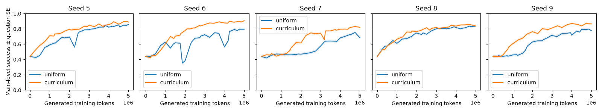
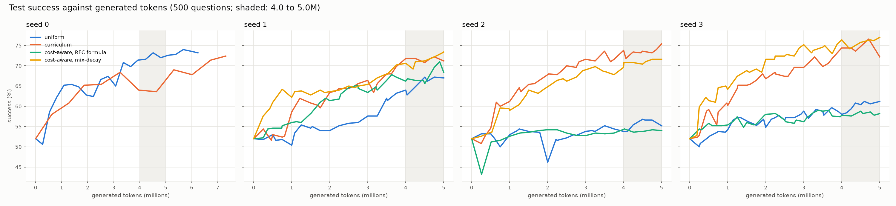

# RFC 013 experiments: the trial and the reference experiment, on one laptop

This branch holds the two experiments reported in the Validation Plan of
[RFC 013: Task Sampling and In-Training Evaluation](https://github.com/Matheus-F-Scatolin/OpenEnv/blob/rfc/013-task-sampling/rfcs/013-task-sampling-and-training-evals.md)
([openenv/OpenEnv#1256](https://github.com/openenv/OpenEnv/pull/1256)):

- **The trial** (Preliminary Results): four samplers on three more seeds, 28 run logs, published on 2026-10-21.
- **The reference experiment**: `UniformSampler` against `CurriculumSampler` on five new seeds and ten finer
  difficulty levels, 10 run logs, published with this commit.

For both you get the trainer, the run logs, the scripts that turn the logs into every table and figure, and the
predictions and reading rules written before the runs. The experiments follow the pilot on
[`rfc-013-pilot`](https://github.com/Matheus-F-Scatolin/OpenEnv/tree/rfc-013-pilot). Like the pilot, the trainer
is standalone, not the API the RFC proposes; only `samplers/` and `evals/` follow the RFC's interfaces.

- **Setup**: Llama-3.2-1B-Instruct (`mlx-community/Llama-3.2-1B-Instruct-bf16`), GRPO with LoRA in MLX, on
  `reasoning_gym_env` `chain_sum`. 8 prompts of 8 answers per step, at most 384 tokens per answer. The date in the
  prompt is fixed to `26 Sep 2026`, the day of the pilot.
- **Trial**: the pilot's five difficulty levels and 500 test questions (100 per level). Runs started between
  2026-10-12 21:51 and 2026-10-13 22:35 UTC. Evaluations at step 0, every 100 steps (every 10 in the 30-step
  runs), every 250,000 generated tokens in the 5-million-token runs, and at the end of each run.
- **Reference experiment**: the ten levels that the RFC's server-side example publishes through the Task API
  (`--ladder rfc`), 1,000 test questions (100 per level), question seed 0, seeds 5 to 9, 5 million generated
  tokens per run. Runs started between 2026-11-09 14:01 and 2026-11-10 11:34 UTC. Evaluations at step 0, every
  100 steps, every 250,000 generated tokens and at the end of each run.
- **Machine**: a 24 GB Apple Silicon laptop for every run. The highest peak memory any run logged is 15.4 GB in
  the trial and 15.5 GB in the reference experiment.





## What is on this branch

- [`samplers/`](samplers/): the `TaskSampler` protocol, `SequentialSampler`, `UniformSampler` and
  `CurriculumSampler`, written to the interface the RFC proposes, outside OpenEnv.
- [`evals/`](evals/): `EvalSchedule`, as the RFC proposes it.
- [`trial/`](trial/): the trainer, `python -m trial.train`. Of the modules it uses, only `trial/mlx_policy.py`
  imports MLX. `trial/run_queue.py` runs a list of runs and skips the complete ones; `trial/compare_logs.py` says
  whether two logs describe the same training; `trial/smoke_pinned.py` is the pilot's script with the date fixed,
  a token budget and a closing `done` line, kept as a fallback and not used for any run here (it imports MLX too).
- [`trial/vendor/reasoning_gym_env/`](trial/vendor/reasoning_gym_env/): `reasoning_gym_env` with the Task API and
  the ten levels, copied from commit `7186e70e` of this fork; the reference experiment runs it in-process.
- [`trial/lists/`](trial/lists/): the run lists, one JSON entry per run (its folder and its command).
- [`trial/runs/`](trial/runs/): the 38 run folders, 195 MB: 28 of the trial (95 MB) and 10 of the reference
  experiment in [`trial/runs/reference/`](trial/runs/reference/) (100 MB). Layout below.
- [`analysis/`](analysis/): `validate_run` checks a run folder; `report` writes every table and figure of the
  trial; `reference` writes the reading of the reference experiment, and `falls` its reading of the falls between
  evaluations; `overlap` counts the test questions of each level that also appear in train; `calibration`
  compares the groups with signal the curriculum predicted with those it got; `pilot_evidence/` reads the pilot's
  logs a second time.
- [`tests/`](tests/): 483 tests. None needs MLX or a GPU.
- [`pilot/`](pilot/): the pilot, as on `rfc-013-pilot`, except one sentence of `pilot/README.md` worded
  differently. The trainer and the tests import from it; the analysis reads its logs.
- [`notes/expectations.md`](notes/expectations.md): the questions, predictions and reading rules, written before
  the runs: sections 1 to 4 for the trial, section 5 for the reference experiment. See below.
- [`notes/results/`](notes/results/): the tables `analysis.report` writes for the trial, and its second reading of
  the pilot's logs (`pilot-evidence.txt`). [`trial.md`](notes/results/trial.md) holds test success per run and the
  differences between methods; [`calibration.md`](notes/results/calibration.md) the predicted and observed groups
  with signal, and how graded the rewards are.
- [`notes/reference-results/`](notes/reference-results/): what `analysis.reference` writes for the reference
  experiment: [`reference.md`](notes/reference-results/reference.md) and `reference.json` (the pre-registered
  reading), two figures, and [`falls.md`](notes/reference-results/falls.md) and `falls.json` (a reading added after
  the results). [`notes/reference-analysis.md`](notes/reference-analysis.md) says what the analysis implements.
- [`figures/`](figures/): the three `trial-*.png` figures from `analysis.report`, and the pilot's figure from
  `pilot/rfc_figure.py`.
- `pyproject.toml`, `uv.lock`, `.python-version`: Python 3.12, with the pilot's versions of every library
  (`tests/test_lock_parity.py` checks this).

The project lived in a folder named `rfc-013/` of the authors' working repository. Some docstrings and one error
message still say `rfc-013/`: that folder is the root of this branch.

## The reference experiment

No GPU and no MLX are needed to read the ten logs again:

```bash
git clone --single-branch -b rfc-013-trial https://github.com/Matheus-F-Scatolin/OpenEnv.git rfc-013-trial
cd rfc-013-trial && uv sync --locked
uv run python -m analysis.reference --runs trial/runs/reference --out /tmp/reference-results
cmp /tmp/reference-results/reference.json notes/reference-results/reference.json
```

It writes `reference.md`, `reference.json`, `success-per-token.png`, `success-per-episode.png`, `falls.md` and
`falls.json`. On macOS (Apple Silicon) `reference.json` was identical, byte for byte, to the committed one, so
`cmp` prints nothing. The output folder must be outside `trial/runs/reference`.

The result, on the 800 test questions of levels 2 to 9 (levels 0 and 1 share test questions with train),
curriculum minus uniform, in points:

| | Seed 5 | Seed 6 | Seed 7 | Seed 8 | Seed 9 | Mean | 95% interval | p |
|---|---|---|---|---|---|---|---|---|
| Per generated token (4.00 to 5.00 M) | +3.7 | +15.2 | +10.4 | +2.7 | +9.2 | +8.2 | +1.9 to +14.6 | 0.023 |
| Per episode (steps 100 to 700) | +12.4 | +3.2 | +5.3 | +2.4 | +12.6 | +7.2 | +1.0 to +13.3 | 0.032 |

Section 5 of `notes/expectations.md` gives the measures, the test and how it is read; the RFC's "Reference
experiment" section discusses the result and what it does not settle.

## Regenerate every table and figure of the trial

```bash
uv run python -m analysis.report
git diff --stat
```

The report rewrites the eight files of `notes/results/` and the three `trial-*.png` figures. On macOS (Apple
Silicon) the rewritten files were identical, byte for byte, to the committed ones, so `git diff --stat` shows
nothing. Other platforms were not tried; their PNG bytes may differ.

## Run the tests

```bash
uv run pytest -q
```

Run them in a git clone, not in an unpacked archive: some of them make tiny runs that must log a git commit. Two
of them compare a fresh reading of the pilot's logs with `notes/results/pilot-evidence.txt`, which the report also
rewrites, so run them on a clean tree. One test skips on this branch: `tests/trial/test_vendor.py` compares
`trial/vendor/` with an OpenEnv clone next to the project folder, which a clone of this branch does not have. On
macOS the suite ends with `482 passed, 1 skipped`.

## Run the experiments again

On an Apple Silicon Mac with 24 GB, from the root of a clone:

```bash
uv sync --locked --group train
uv run hf download mlx-community/Llama-3.2-1B-Instruct-bf16
export HF_HUB_OFFLINE=1
uv run python -m trial.preflight
```

- Without `--group train`, `uv sync` does not install MLX.
- The logs record model snapshot `863c846a9ac6fad4e49e1743d52984dff262e953`; the preflight prints the snapshot
  on your machine and ends with `preflight: OK`.
- The queue skips every complete run folder, so the published runs are moved aside first. Add `--dry-run` to see
  what would run. Started again after a stop, the same command skips the runs already complete.

The reference experiment, from this commit:

```bash
mv trial/runs/reference trial/runs/reference-published
caffeinate -is uv run python -m trial.run_queue trial/lists/reference.json
uv run python -m analysis.validate_run trial/runs/reference
```

The trial ran on an earlier version of the trainer, the previous commit of this branch,
`b984319672adbf429903b6fcb27b4feaa85122a7`. To run it again with that code, check that commit out first
(`git checkout b984319672adbf429903b6fcb27b4feaa85122a7`), then:

```bash
mv trial/runs trial/runs-published
caffeinate -is uv run python -m trial.run_queue trial/lists/ten-run.json trial/lists/probes.json trial/lists/trial.json trial/lists/cost-rfc.json trial/lists/cost-mix-decay.json trial/lists/seed0-repeat.json trial/lists/seed3.json trial/lists/seed3-mix-decay.json
uv run python -m analysis.validate_run trial/runs
```

| Run list | Runs | Folder under `trial/runs/` |
|---|---|---|
| `ten-run.json` | Seeds 0 to 4, `uniform` and `curriculum`, 30 steps each | `ten-run/` (10) |
| `probes.json` | The untrained model on ten finer levels; the three token-weighted methods on seed 0, 100 steps each | `ladder-probe/` (1), `cost-probe/` (3) |
| `trial.json` | Seeds 1 and 2, `uniform` and `curriculum`, 5 million generated tokens each | `trial/` (4) |
| `cost-rfc.json` | Seeds 1 and 2, `curriculum-tokens`, 5 million tokens | `cost-full/` (2) |
| `cost-mix-decay.json` | Seeds 1 and 2, `curriculum-tokens-mix-decay`, 5 million tokens | `cost-full/` (2) |
| `seed0-repeat.json` | Seed 0, `uniform` and `curriculum`, 1 million tokens | `seed0-repeat/` (2) |
| `seed3.json` | Seed 3, `uniform`, `curriculum` and `curriculum-tokens`, 5 million tokens | `seed3/` (3) |
| `seed3-mix-decay.json` | Seed 3, `curriculum-tokens-mix-decay`, 5 million tokens | `seed3/` (1) |
| `reference.json` | Seeds 5 to 9, `uniform` and `curriculum`, `--ladder rfc`, 5 million tokens | `reference/` (10) |

The other lists have no folder here: `gate-queue.json`, `gate-queue-pinned.json` and `gate-queue-ref.json` are
tiny checks meant to run before the experiments, and their folders were not published; `pinned-*.json` are the
fallback with `trial/smoke_pinned.py`, never run; `reference-staircase.json` is the reference experiment's
pre-registered fallback, not needed; `rehearsal-mac.json` is a tiny rehearsal that writes to `/tmp`.

## How the logs are laid out

Each run has a folder `trial/runs/<experiment>/llama3.2-1b-<method>-s<seed>/`. The methods:

- `uniform`: every level equally often.
- `curriculum`: `CurriculumSampler` with its defaults, the pilot's weights: the chance that a group carries GRPO
  signal, plus `eps`, with cost counted in episodes.
- `curriculum-tokens`: the same weight divided by the level's moving average of generated tokens
  (`cost="tokens"`), the formula of the RFC's first version.
- `curriculum-tokens-mix`: signal per token, with every level kept at `eps` or more (`floor="mixture"`).
- `curriculum-tokens-mix-decay`: as `-mix`, with a prior that fades (`prior="decayed"`).
- `baseline`: no training; the ladder probe.

Each folder holds:

- `log.jsonl`: one event per line. A `config` event (schema version 2) with every setting, the seed, the prompt
  date, library versions, Python, platform, model snapshot, `git_commit` and `git_dirty`; then `step` and `eval`
  events; then `done` with the stop reason. A run is complete only when its last line is `done`. Fields that the
  pilot's log also has keep its names, so `trial.compare_logs` can compare the two.
- `evals.jsonl`: one line per test question per evaluation: level, reward, generated tokens, cut at the limit.
- `questions.jsonl`: the test questions and their answers.
- `eval_texts.jsonl.gz`: the text of every test answer.
- `sampler_state.json`: the sampler's state at the last evaluation (not in the baseline's folder).

All 38 runs are complete, and `python -m analysis.validate_run trial/runs` prints `OK` for each.

## What `git_commit` in the logs means

Every `config` event has `git_dirty` false and a `git_commit` of the authors' private working repository, which
cannot be resolved here.

- **Trial**: `ca260b9a715704b3b624e3a6876442ff8b363afc`. Its code is the previous commit of this branch,
  `b984319672adbf429903b6fcb27b4feaa85122a7`, whose README lists what differs from it: only scripts that read the
  logs, and their outputs.
- **Reference experiment**: `9ac3c5d715c14501e515c149c34c68938c236845`, the commit tagged `reference-freeze` there
  plus one commit that changes only a notes file not published here. Compared with it, this commit adds
  `analysis/reference.py`, `analysis/falls.py` and their tests, `tests/analysis/test_reference.py` and
  `tests/analysis/test_falls.py`, all of them only reading the logs, `notes/reference-results/` and
  `notes/reference-analysis.md`. As in the previous commit, `tests/analysis/test_report.py` and
  `tests/analysis/test_pilot_evidence.py` read the pilot evidence from `notes/results/`. Everything else published
  here is the same, byte for byte: among it `samplers/`, `evals/`, `trial/*.py`, `trial/vendor/`,
  `trial/lists/*.json`, `pyproject.toml`, `uv.lock` and `notes/expectations.md`.

The trainer imports nothing from `analysis/` or `tests/`. A run started from this branch logs this branch's commit.

## When the predictions and the reading rules were written

`notes/expectations.md` gives its own dates; the commits that prove them are in the private repository and cannot
be checked from here.

- **Trial**: sections 1 to 4 were committed on 2026-10-12 at 18:49:23 UTC, in commit `a311ad0` of that
  repository, and have not changed since. The first trial run started at 21:51:06 UTC that day, from a commit that
  descends from it.
- **Reference experiment**: section 5 was added on 2026-11-08 at 19:42 UTC, in commit `cb7c2a7`, the only change
  to the file since `a311ad0` (blob now `e6398e31e32c646d28ebfde662a9ee09207bb44b`). It was pushed to the private
  repository at 21:26 UTC that day, before the first reference run (2026-11-09 14:01 UTC), and every reference run
  logs a commit that contains it. The script that applies it, `analysis/reference.py`, was committed at 21:48 UTC
  the same day, also before the runs, but it is not in the commit the runs logged and was pushed only after the
  results. After the results had been read, three changes were made to the analysis, none changing a computed
  value of the pre-registered reading: the tables of `reference.md` show four significant digits, `roots` in
  `reference.json` keeps the paths as given, and `analysis/falls.py` was added, with thresholds chosen after the
  results. `notes/reference-analysis.md` records them.
- Neither the rules of section 5 nor the analysis was public before this commit.

The file names documents that are not published:

- `interface.md`, for "the three formulas": they are the three token-weighted methods above, implemented in
  `samplers/curriculum.py` and selected in `trial/loop.py`.
- `trial/RUNBOOK.md`, the run instructions, which call the three checks of the first decision rule G4, G5 and G6.
  Their run folders were not published. What G4 asks is shown by the trial's runs, with
  `python -m trial.compare_logs` (for example `python -m trial.compare_logs
  pilot/runs/pilot/llama3.2-1b-uniform-s0/log.jsonl trial/runs/seed0-repeat/llama3.2-1b-uniform-s0/log.jsonl
  --steps 370`): the seed-0 repeat is identical to the pilot's stored logs in all its steps (370 for `uniform`,
  158 for `curriculum`), and the ten-run's seed 0 is identical to the pilot's first 30 steps for both methods.
  Before the reference runs, the trainer of this commit was checked the same way against the pilot's stored 20-step
  logs (`pilot/runs/smoke/`) and was identical for both methods. Every run passes `validate_run`, which G5 asks of
  a short run. The new trainer made every run.

Some rows still read "_to fill in_": the file's own rule keeps a prediction from being added after its run started,
so they stay blank.

## Not on this branch

- The LoRA adapters (`adapters*.safetensors`) and the training texts (`train_texts.jsonl.gz`), which the runs
  write but were never committed.
- The folders of the gate checks, of October and of November, the queue's own log,
  `trial/lists/queue-log.jsonl`, and its console output, `trial/lists/output/`.
- The authors' working notes, including `interface.md`, `trial/RUNBOOK.md` and its test,
  `tests/trial/test_runbook.py`.
- The RFC itself, which is on the branch `rfc/013-task-sampling`.

`pilot/vendor/reasoning_gym_env/` is copied from huggingface/OpenEnv at commit `9e0fd9b`, and
`trial/vendor/reasoning_gym_env/` from commit `7186e70e` of this fork; both keep that project's BSD-3-Clause
license.

Authors: @Matheus-F-Scatolin, @tiagoperrupato.
